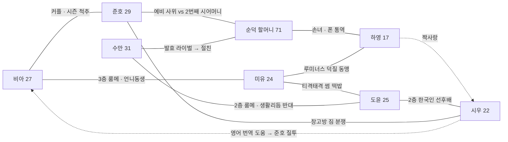

# 연남동 3층집 캐스트 바이블 v01 — 8명 성격 + 관계도

작성 2026-11-04. 기준: `WORLD_PLAN_PH_v03.md` 3절(6명) + 인수인계(11-04)의 하영·시우 추가. 얼굴은 `CAST_v8_six/` 확정본.

## 도윤이 누구인가 (이도윤 · 25 · 한국 · 2층 뒷방)

한 줄: **거실 바로 위에 사는 단톡방 총무. 모든 일을 '콘텐츠 각'으로 보는데, 정작 자기 인생은 각이 안 나오는 취준생.**

| 항목 | 내용 |
|---|---|
| 현재 | 취준 2년 차. 면접 12번 탈락. 부모님께는 "작은 스타트업 다닌다"고 말해 둠 → 순덕 할머니만 진실을 앎 |
| 꿈 | 유튜버. 구독자 312명. 채널명 「연남동 3층집 TV」 (룸메들 동의 안 받고 개설, 시즌 중 들통) |
| 방 | 2층 뒷방, 거실 천장 바로 위. 삼각대·링라이트 상시 세팅. 거실 소리가 다 들려서 1층 비밀을 가장 먼저 앎 |
| 성격 ① 설명충 | 외국인 룸메에게 한국어·한국 상식을 가르치려 드는데, 분리수거·관공서·경조사 같은 건 본인이 더 모름. 수만이 주민센터를 더 잘 앎 |
| 성격 ② 눈치는 빠르고 실행은 느림 | 분위기는 제일 먼저 읽는데 행동은 "검색 좀" 하다가 타이밍을 놓침 |
| 성격 ③ 쪼잔한데 정 많음 | 총무라 공과금은 10원 단위로 나누면서, 누가 힘들어 보이면 편의점 야식을 다 사 옴 |
| 말버릇 | "그건 내가 알려줄게요… 아 잠깐, 검색 좀." / "이거 각인데?" |
| 집착 / 소품 | 조회수 / 삼각대, 화이트보드 마커(냉장고 공과금 보드 담당), 목에 건 헤드폰 |
| 하루 | 밤샘 편집 → 낮잠 → 저녁 거실로 내려와 '중계' → 새벽 수만 귀가 소리에 깸 |
| 웃음 공식 | 아는 척 → 검색 → 틀림 → 외국인 룸메가 정답. 또는 몰래 찍다 걸림 |
| 약점 | 엄마 전화. "회사는 잘 다니지?" 하면 거실 전원이 조용해짐 |
| 성장선 | 시즌 후반, 룸메들이 채널을 알게 되고 화내는 대신 출연을 자청함. 첫 영상이 터지는 게 시즌 피날레 후보 |

## 8명 한 줄 요약

| 이름 | 나이·국적 | 사는 곳 | 한 줄 | 말버릇 | 집착 / 소품 |
|---|---|---|---|---|---|
| 비아 | 27 · 필리핀 엄마+미국 아빠 | 3층 앞방 | 밝고 추진력. 모든 값을 페소와 '동생 등록금'으로 환산. 가족방 22명이 준호를 실시간 심사 | "Sana all~" / "오빠, 계산해 봤어?" | 송금·가격 비교 / 3-in-1 커피믹스, 송금 앱 |
| 준호 | 29 · 한국 | 세입자 아님(창고방 짐) | 겉은 멀쩡, 속은 걱정쟁이. 영어 거의 못해 토마톡 번역에 의존. 매일 3층까지 올라옴 | "아니 잠깐만, 정리 좀 하자." | 예비 사위 점수 / 사원증 목걸이, 신발장 밖 구두 |
| 순덕 할머니 | 71 · 한국 | 옆집 (건물주) | 오지랖 100%. 평상이 CCTV. 외국인 이름을 한국식으로 부름 | "밥은 먹었고?" / "내가 다 안다." | 반찬 배급 / 반찬통, 꽃무늬 몸뻬 |
| 미유 | 24 · 일본 오사카 | 3층 뒷방 | 평소 조용, 덕질이면 폭발. 응원법·드라마로 배운 한국어라 사극체 섞임 | "진짜 레전드…" | 가상 아이돌 '루미너스' / 응원봉, 포토카드 |
| 수만 | 31 · 네팔 포카라 | 2층 앞방 | 집안의 아빠. 분쟁을 밥으로 해결. 주방 한국어(반말·존댓말 혼합) | "괜찮아, 일단 먹고." | 발효 / 유리 피클병, 앞치마 |
| 도윤 | 25 · 한국 | 2층 뒷방 | 위 참조 | "그건 내가 알려줄게요… 아 잠깐, 검색 좀." | 조회수 / 삼각대, 마커, 헤드폰 |
| 하영 | 17 · 한국 | 옆집 (할머니 집, 주말) | 순덕 손녀. K-pop 덕후 고등학생. 할머니 폰·단톡 세팅 담당이라 할머니 음성메시지의 '공식 통역'. 시우 보러 할머니 심부름을 자원함 | "할머니, 그거 아니라니까!" / "헐 대박" | 포토카드 / 키링, 폰 |
| 시우 | 22 · 한국 | 2층 창고방 (제안) | 대학생. 조용하고 어른스러운 막내. 영어를 잘해서 비아 가족방 번역을 도와주다 준호의 질투 대상. 하영의 마음은 전혀 모름 | "아, 그건 그냥…" (말 줄임) | 과제 / 백팩, 아이패드 |

## 시우 거주지 제안 (확인 필요)
월드플랜 v03에서 2층은 앞방 수만, 뒷방 도윤, 창고방 빈방(준호 짐)이다. 인수인계의 "2층 사는 대학생"을 살리려면 **시우가 창고방 세입자**가 되는 게 가장 깔끔하다. 준호 짐은 시우 방 한쪽에 얹혀 있고, 시우가 "형, 이거 언제 빼요"를 못 하는 성격이라 짐이 계속 늘어난다. 이러면 창고방의 '입주자 교체 슬롯' 설정은 옆집 2층(할머니 집 빈 2층)으로 옮긴다.

## 관계도

| 관계 | 축 | 반복되는 장면 |
|---|---|---|
| 비아 ↔ 준호 | 커플, 시즌 척추 | 돈·가족·설명으로 싸움. 창고방 짐이 '동거냐 아니냐' 논쟁 |
| 준호 ↔ 순덕 | 예비 사위 vs 시어머니 | 월급 추궁, 출입 횟수 카운트 |
| 미유 ↔ 도윤 | 썸인지 싸움인지 | 계단참이 둘의 무대. 도윤이 미유 콘서트 중계를 몰래 찍다 걸림 |
| 수만 ↔ 도윤 | 2층 룸메, 벽 하나 | 새벽 귀가 vs 밤샘 편집. 수만이 주민센터를 도윤보다 잘 앎 |
| 수만 ↔ 순덕 | 김치 vs 아차르 | 발효 배틀 → 서로 반말하는 절친 |
| 비아 ↔ 미유 | 3층 룸메, 욕실 공유 | 절약 vs 덕질 소비. 비아는 영어, 미유는 한국어로 대화하는 비대칭 |
| 순덕 ↔ 하영 | 할머니와 손녀 | 하영이 할머니 폰을 세팅하고 음성메시지를 글로 통역. "할머니, 그거 아니라니까!" |
| 하영 → 시우 | 짝사랑 (일방) | 할머니 반찬 심부름을 자원해 3층집에 옴. 시우는 동생으로만 봄 |
| 시우 ↔ 준호 | 창고방 짐 | 시우 방에 준호 짐이 쌓임. 시우는 말 못 하고 도윤이 대신 따짐 |
| 시우 → 비아 | 영어 번역 도우미 | 비아 가족방 영어를 시우가 자연스럽게 읽음 → 준호 질투 라인 |
| 미유 ↔ 하영 | 덕질 동맹 | 루미너스 티켓팅 공동 작전. 하영은 미유의 유일한 한국인 덕후 친구 |
| 도윤 ↔ 시우 | 2층 한국인 선후배 | 도윤은 '형' 대접을 원하는데 시우가 더 어른스러움 |
| 도윤 ↔ 전원 | 총무 | 공과금 ÷ 몇 명이냐 논쟁(준호·시우 포함 여부). 욕은 다 도윤이 먹음 |

국적 밸런스: 한국 4(준호·순덕·도윤·시우, 손님 하영), 필리핀계 1, 일본 1, 네팔 1.
